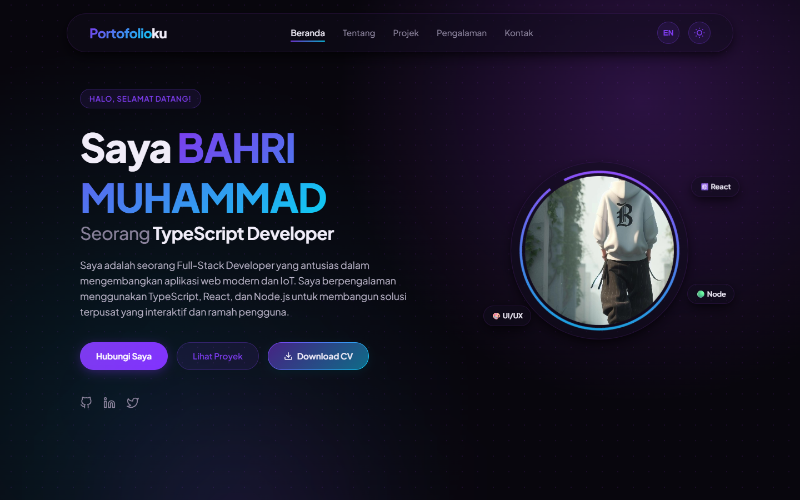

<p align="center">
  
</p>

<h1 align="center">Portofolioku</h1>

<p align="center">
  <strong>Personal portfolio of Bahri Muhammad — full-stack developer in Mataram, Indonesia.</strong>
</p>

<p align="center">
  <a href="https://portofolioku-ochre-nu.vercel.app"></a>
  <a href="LICENSE"></a>
  
  
</p>

A single-page portfolio covering projects, technical skills, experience, and
contact details. It is built with React and Vite, with no UI framework or
animation library.

## Features

- **Bilingual** — Indonesian and English copy, remembered in `localStorage`.
- **Dark and light themes** — system-independent toggle, also persisted.
- **Sections** — home, about, projects, experience, and contact, with active
  navigation based on scroll position.
- **Motion** — scroll progress bar, reveal-on-scroll via `IntersectionObserver`,
  and a typewriter hero. Motion stays lightweight and dependency-free.
- **Project cards** — screenshots, stack tags, and links for selected work.
- **CV download** — a print-ready HTML CV in `public/`.
- **Responsive layout** — tested from mobile through desktop.

## Tech stack

- React 19
- Vite 8
- Modern CSS (custom properties, grid, container queries)
- ESLint

## Run locally

Requirements: Node.js 20+ and npm.

```bash
npm install
npm run dev
# open the URL printed by Vite
```

Build and preview the production bundle:

```bash
npm run build
npm run preview
```

Lint:

```bash
npm run lint
```

## Project structure

```text
public/               Avatar, project screenshots, CV, favicon
src/
  components/         Navbar, Hero, About, Projects, Experience, Contact, Footer
  data/               Portfolio content and UI translations
  App.jsx             Theme, language, and active-section state
  App.css             Layout, themes, and motion styles
docs/preview.png      README screenshot
```

## Deploy

The site is deployed on Vercel. Import the repository, keep the default Vite
settings, and set the output directory to `dist`.

## License

Source code is released under the [MIT License](LICENSE). The name, avatar,
CV, project screenshots, and other personal content are not licensed for reuse.
